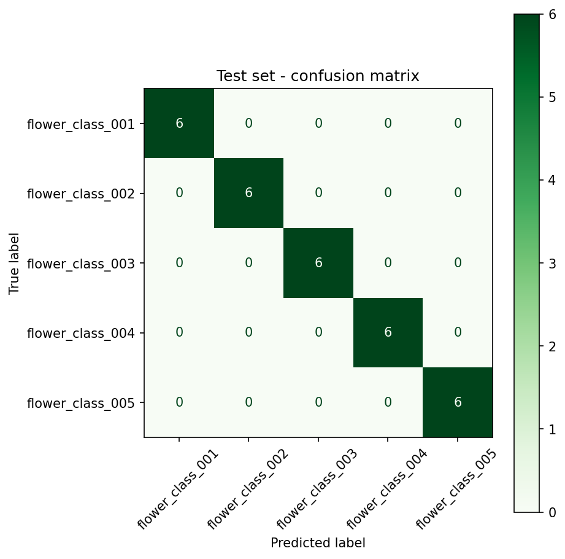
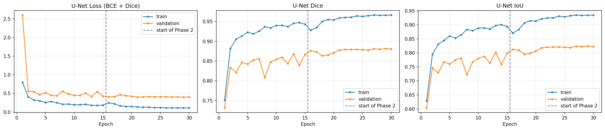
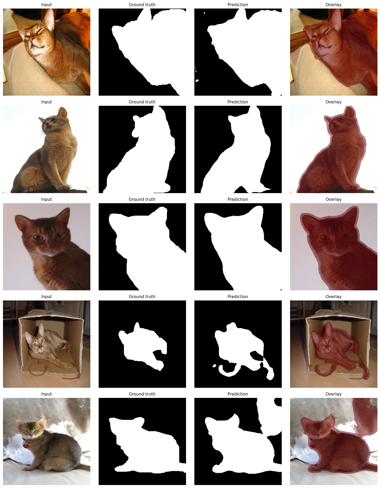

# BSCS23067-assignment
Fine-tuning ResNet-50 and U-Net on small image datasets.

**Name:** Ahmad Liaqat
**Roll No:** BSCS23067
**Course:** ANN & Deep Learning, Assignment 02

---

## What this is about
Training a CNN from scratch needs thousands of labelled images. Here I only had around 150-200 images per dataset, so I used transfer learning. I took models that were already trained on ImageNet and fine-tuned them on my small datasets.

I did two parts:
- **Part A:** ResNet-50 for image classification (which flower is this?)
- **Part B:** U-Net with a ResNet-50 encoder for segmentation (which pixels are the pet?)

Both models were trained in two phases. First I froze the pretrained part and trained only the new layers. Then I unfroze the last few layers and trained again with a smaller learning rate, so the pretrained weights only change a little.

## Repo structure
```text
BSCS23067-assignment/
├── README.md
├── notebook/
│   └── bscs23067_asm02.ipynb         # full notebook, saved with outputs
└── results/
    ├── resnet_results.png            # ResNet-50 loss & accuracy curves
    ├── resnet_confusion_matrix.png   # ResNet-50 test set confusion matrix
    ├── unet_curves.png               # U-Net loss, Dice, and IoU curves
    └── unet_predictions.png          # U-Net predictions on test images
```

I didn't upload the datasets or the trained weights (`.pth`). The U-Net weights are over GitHub's 100 MB limit.

## Datasets
| | Classification | Segmentation |
|---|---|---|
| **Dataset** | Oxford Flowers-102 (small subset) | Oxford-IIIT Pet (small subset) |
| **Link** | https://www.robots.ox.ac.uk/~vgg/data/flowers/102/ | https://www.robots.ox.ac.uk/~vgg/data/pets/ |
| **What I used** | 5 classes x 40 images = 200 images | 150 image + mask pairs |
| **Split** | 140 / 30 / 30 (train / val / test) | 106 / 22 / 22 (train / val / test) |

For the pet masks, the original trimap has `1 = pet`, `2 = background`, `3 = border`. I turned it into a binary mask where pet and border are 1 and background is 0.

## How to run it
1. Open the notebook in Google Colab and set the runtime to **T4 GPU** (Runtime -> Change runtime type). It is really slow on CPU.
2. Put the datasets on Google Drive like this:
   ```text
   MyDrive/
   └── ANN_DL_Assignment/
       ├── flowers_subset/      # one folder per class, *.jpg inside
       └── pets_subset/
           ├── images/          # *.jpg
           └── masks/           # *.png, same name as the image
   ```
3. Run all cells from top to bottom. It installs `segmentation-models-pytorch` by itself and mounts Drive.
4. The best checkpoints are saved in `ANN_DL_Assignment/checkpoints/` and the figures in `/content/results`.

Seeds are fixed, so the results should come out the same or very close.

---

## Part A: ResNet-50 (Classification)
- Replaced the last `fc` layer (2048 -> 1000) with a new one (2048 -> 5) for my 5 flower classes.
- Training images get resized to 224x224, random flip, rotation (15°) and colour jitter. Validation and test images are only resized and normalized, no augmentation.
- **Phase 1:** whole backbone frozen, only `fc` trains. 10,245 trainable parameters, AdamW, lr = 1e-3, 10 epochs.
- **Phase 2:** unfroze `layer4` too. 14,974,981 trainable parameters, lr = 1e-4 with cosine scheduler, 10 epochs.
- Frozen BatchNorm layers are kept in eval mode, so the small dataset doesn't mess up the pretrained running stats.

### Results
| ResNet-50 Metric | Result |
| --- | ---: |
| Training Accuracy | 1.000 |
| Validation Accuracy | 0.967 |
| Test Accuracy | 1.000 |
| Precision (macro) | 1.000 |
| Recall (macro) | 1.000 |
| F1-score (macro) | 1.000 |




**What I noticed:**
- Fine-tuning helped, but not in validation accuracy. That stayed at 0.967 after both phases. Validation loss dropped from 0.48 to 0.16 though, so the model got a lot more confident.
- You can see a jump in train loss right when Phase 2 starts. That's because `layer4` suddenly starts learning. It settles down in about 2-3 epochs.
- No test image was misclassified. The 5 classes look very different in colour and shape, so the ImageNet features separate them easily. With only 6 test images per class I wouldn't expect 100% to hold on a bigger test set.

---

## Part B: U-Net (Segmentation)
- U-Net from `segmentation-models-pytorch` with a ResNet-50 encoder pretrained on ImageNet, 1 output channel.
- Images and masks are resized to 256x256. Any flip or rotation is applied the same way to both the image and its mask. Masks use NEAREST interpolation so they stay exactly 0 or 1.
- **Loss:** BCE + Dice. BCE looks at every pixel on its own, and Dice looks at the overlap, so it doesn't get fooled when the pet is small.
- **Phase 1:** encoder frozen, only decoder + head train. 9,013,073 trainable parameters, lr = 1e-3, 15 epochs.
- **Phase 2:** unfroze encoder `layer3` and `layer4`. I used different learning rates for each group: 1e-4 for the encoder layers and 3e-4 for the decoder + head. 15 epochs.

### Results
| U-Net Metric | Result |
| --- | ---: |
| Training Loss | 0.1017 |
| Validation Loss | 0.4013 |
| Validation Dice | 0.881 |
| Test Dice | 0.920 |
| Test IoU | 0.857 |
| Test Pixel Accuracy | 0.944 |

Best validation Dice went from 0.868 after Phase 1 to 0.881 after Phase 2. Small, but it did improve.





**What I noticed:**
- Most mistakes are at the boundaries, mainly around fluffy fur edges, tails and paws.
- It gets confused by background that has a similar colour or texture to the pet. In sample 3 it marked part of a cardboard box and a cable, and in sample 5 a blob on the fur blanket.
- Thin parts like the tail sometimes get cut short.
- Validation Dice jumps around a lot in Phase 1, then gets much smoother in Phase 2 once the encoder is also adapting.

---

## Summary
| Model | Dataset | Task | Main Metric | Result |
| --- | --- | --- | --- | ---: |
| ResNet-50 | Oxford Flowers-102 | Classification | Accuracy | 1.000 |
| U-Net | Oxford-IIIT Pet | Segmentation | Dice / IoU | 0.920 / 0.857 |

Even with only 150-200 images, both models did well because they started from pretrained weights. Doing it in two phases (train the new head first, then gently unfreeze the deeper layers) kept training stable and stopped the small dataset from wrecking the pretrained features.

## Libraries used
PyTorch, torchvision, segmentation-models-pytorch, scikit-learn, NumPy, pandas, Matplotlib, Pillow
